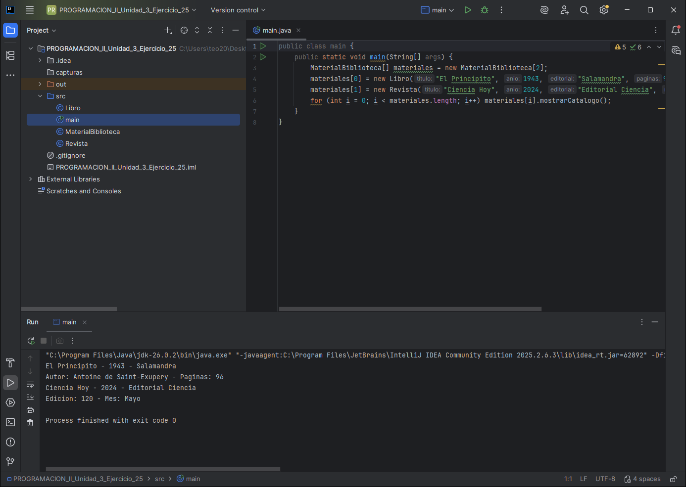

# PROGRAMACIÓN II — Unidad 3, Ejercicio 25: Biblioteca y Clasificación de Materiales de Lectura

Trabajo práctico de Programación II. Este repositorio contiene la resolución en Java del ejercicio 25 de la Unidad 3.

## Consigna

#### Contexto

Una biblioteca administra diversos recursos físicos y digitales para sus socios. Si bien los libros y las revistas comparten el título, el año de edición y la editorial, los libros se catalogan por cantidad de páginas y autor, mientras que las revistas se organizan por número de edición y mes de publicación.

#### Consigna

Implementar una jerarquía de clases en Java que permita gestionar distintos tipos de materiales bibliográficos mediante el uso de herencia y reutilización de código.

#### Desarrollo requerido

- Definir la clase base MaterialBiblioteca con atributos comunes (titulo, anioEdicion, editorial) y métodos de consulta estándar.
- Crear las clases hijas Libro y Revista que extiendan de la clase base añadiendo sus atributos y métodos particulares.
- Asegurar el uso correcto de constructores mediante super(...) en cada subclase.
- En el método main, armar una colección mixta de materiales, recorrerlos de manera polimórfica o específica y mostrar sus catálogos por consola.

## Estructura del repositorio

```
PROGRAMACION_II_Unidad_3_Ejercicio_25/
├── README.md
├── capturas/
│   └── consola.png
└── src/
    ├── Libro.java
    ├── main.java   # clase con el método main
    ├── MaterialBiblioteca.java
    └── Revista.java
```

## Funcionamiento y lógica

El ejercicio aplica **polimorfismo con un arreglo de la superclase** en el catálogo de una biblioteca.

### `MaterialBiblioteca` (clase base)

Tiene `titulo`, `anioEdicion` y `editorial` (`protected`). Su método `mostrarCatalogo()` los imprime en una línea.

### `Libro` y `Revista`

Heredan de `MaterialBiblioteca` y sobrescriben `mostrarCatalogo()`: llaman a la versión base y después agregan sus propios datos.

- **Libro:** autor y cantidad de páginas.
- **Revista:** número de edición y mes de publicación.

### `main`

Crea un arreglo `MaterialBiblioteca[]` con *El Principito* (libro) y *Ciencia Hoy* (revista) y lo recorre con un `for` llamando a `mostrarCatalogo()`. Cada elemento muestra la información que le corresponde según su tipo.

## Ejecución

Captura de la consola de IntelliJ IDEA ejecutando el programa:



Salida obtenida:

```
El Principito - 1943 - Salamandra
Autor: Antoine de Saint-Exupery - Paginas: 96
Ciencia Hoy - 2024 - Editorial Ciencia
Edicion: 120 - Mes: Mayo
```
